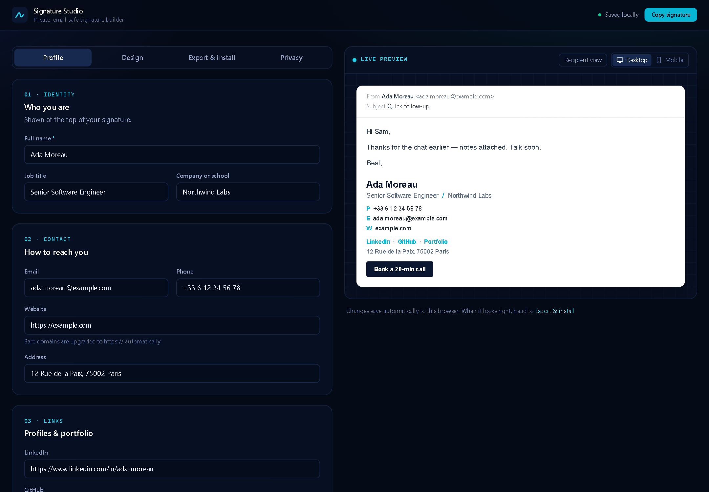
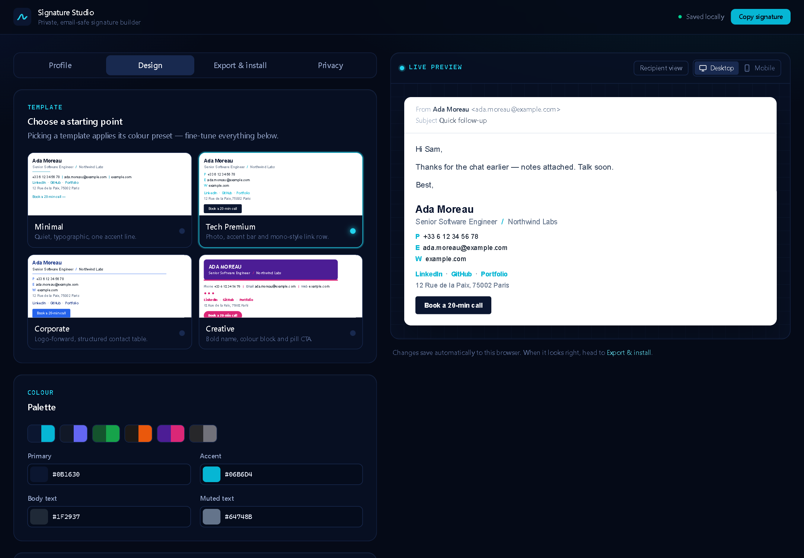
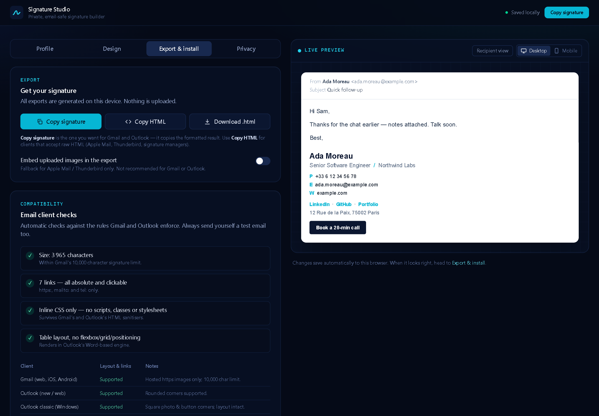
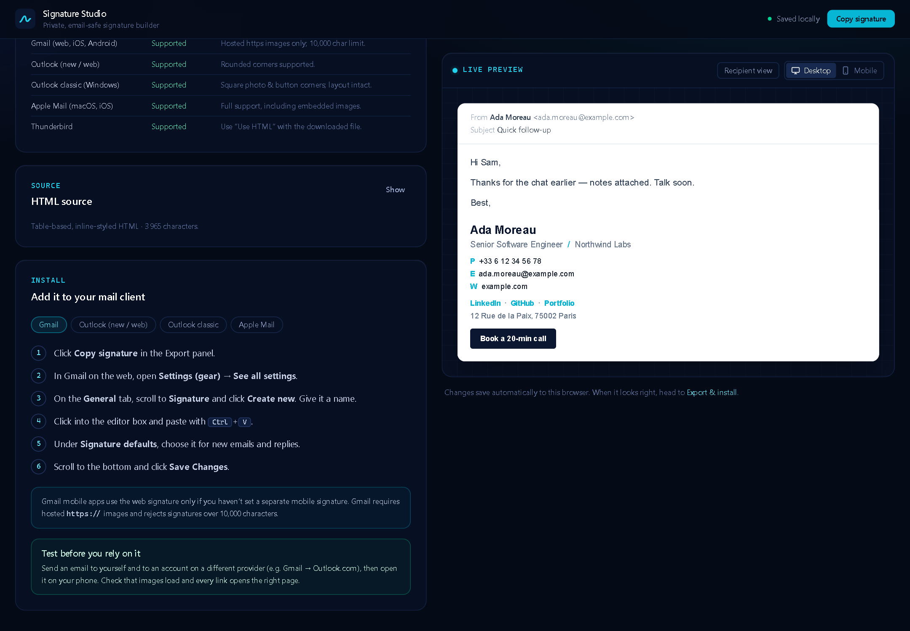
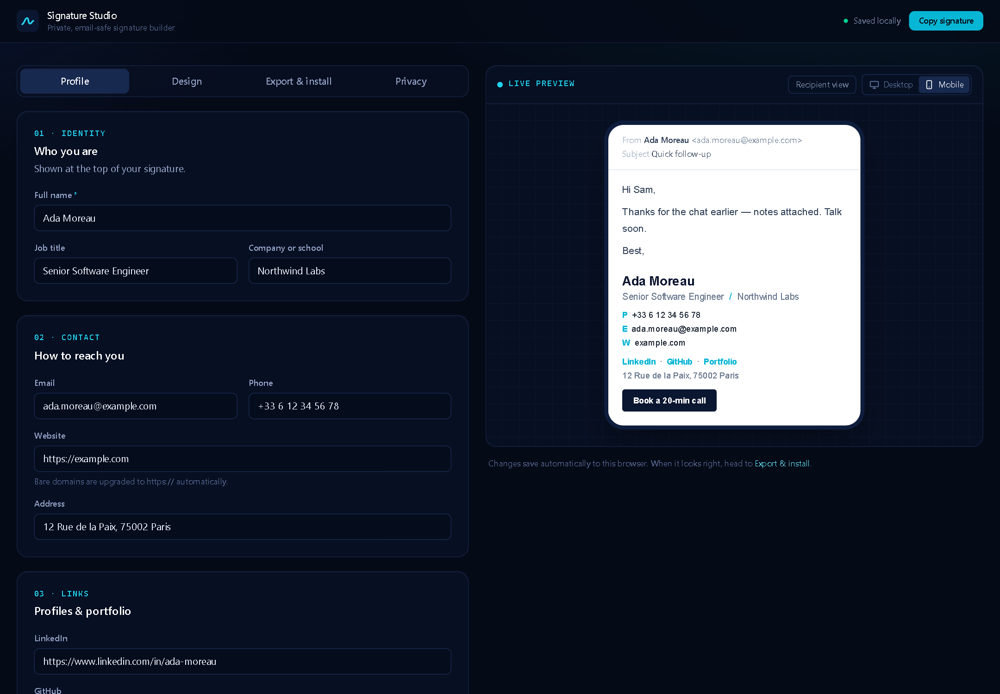
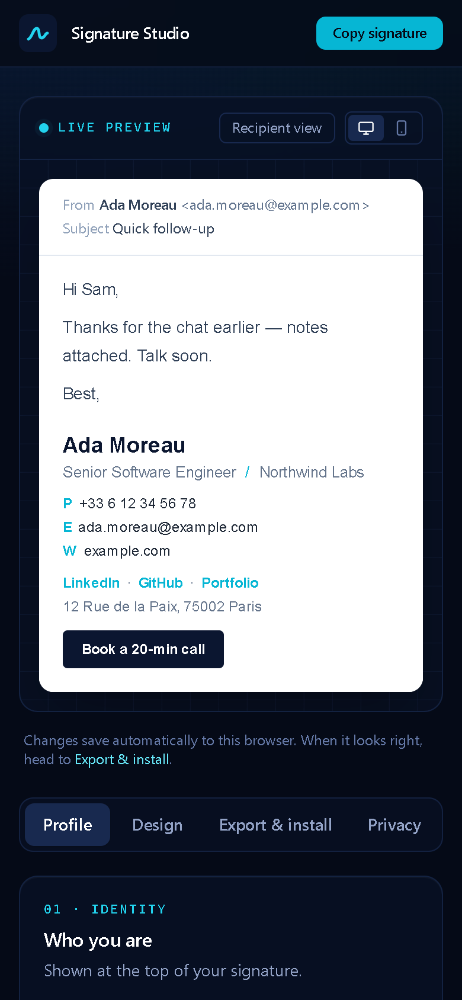

# Signature Studio

A private, local-only email signature builder. Design a signature with a live preview, then export **email-safe HTML** (table layout, inline CSS, no scripts) that works in Gmail, Outlook and Apple Mail.

- No backend, analytics, tracking pixels, cookies or external fonts
- Settings are saved in your browser's `localStorage` and nowhere else
- Uploaded photos and logos are resized in the browser and never transmitted



## Screenshots

| Design studio | Export & compatibility checks |
| --- | --- |
|  |  |
| **Install guides** | **Mobile preview mode** |
|  |  |

<p align="center"></p>

## Features

- **Profile editor**: name, title, company or school, email, phone, website, LinkedIn, GitHub, portfolio, address, call-to-action button, photo and logo, with validation as you type
- **Four original templates** (Minimal, Tech Premium, Corporate, Creative) with custom colours, font, size, spacing, separators, alignment and photo style
- **Live preview** in desktop and mobile modes, plus a *Recipient view* that shows exactly what gets exported
- **Email-safe export**: copy the formatted signature, copy the HTML source, or download an `.html` file
- **Built-in compatibility checks** (Gmail's 10,000-character limit, image hosting, links, inline CSS, Outlook-unsafe CSS)
- **Install guides** for Gmail, Outlook (new/web), Outlook classic and Apple Mail

## Requirements

- [Node.js](https://nodejs.org/) 18 or newer (20+ recommended)
- Windows, macOS or Linux

## Setup (Windows)

Open **PowerShell** or **Command Prompt** in the project folder:

```powershell
npm install
npm run dev
```

The app opens at <http://localhost:5173>. Stop it with `Ctrl+C`.

### Other commands

| Command             | What it does                                        |
| ------------------- | --------------------------------------------------- |
| `npm run dev`       | Development server with hot reload                  |
| `npm run build`     | Type-check and build a production bundle to `dist/` |
| `npm run preview`   | Serve the production build locally                  |
| `npm test`          | Run unit and UI tests (Vitest + jsdom)              |
| `npm run typecheck` | TypeScript check only                               |

## Using it

1. **Profile**: replace the sample data (fictional "Ada Moreau") with your own. Invalid fields are highlighted and left out of the export.
2. **Design**: pick a template (Minimal, Tech Premium, Corporate, Creative), then adjust colours, font, size, spacing, separators, alignment and photo style. Switch between desktop and mobile preview.
3. **Export & install**:
   - **Copy signature** copies the formatted signature. Use this for Gmail and Outlook.
   - **Copy HTML** copies the raw source, for clients and tools that accept HTML.
   - **Download .html** saves a standalone file you can open in a browser and copy from.
   - Step-by-step guides for Gmail, Outlook (new/web), Outlook classic and Apple Mail are in the app.

Turn on **Recipient view** in the preview to see exactly what gets exported.

## Images: why hosting is needed

A signature is copied into every email you send. The recipient's mail app downloads each image from the URL written in the signature, so **an image on your computer can't be seen by anyone else**.

- An uploaded image is shown in the preview only and is **left out of the export** until you provide a hosted URL.
- To show your photo or logo to recipients, upload it somewhere public that you choose (your website, a CDN, a public cloud bucket) and paste its direct `https://` link into **Hosted image URL**.
- There is also an opt-in **Embed uploaded images** option (base64). Gmail strips these, Outlook often turns them into attachments, and they easily exceed Gmail's 10,000-character signature limit. Use it only for Apple Mail or Thunderbird.

## Email compatibility

The exporter follows email HTML conventions:

- Nested `<table role="presentation">` layout, with no flexbox, grid or positioning
- Inline styles on every cell, with no `<style>`, classes or scripts
- Email-safe system font stacks only
- `width`/`height` attributes and `alt` text on every image
- Buttons built as `bgcolor` table cells so they render in Outlook's Word engine
- Only `https:`, `mailto:` and `tel:` links. Everything else is rejected, and all user text is HTML-escaped.

The **Email client checks** panel runs these rules against your actual output, including the Gmail length limit. Automated checks can't replace a real test: send yourself an email and open it in Gmail, Outlook and on your phone.

Known client differences: classic Outlook for Windows shows square corners on photos and buttons, and some clients ask before loading remote images.

## Project structure

```
src/
  App.tsx                    App shell, tabs, toasts
  components/                UI: ProfileEditor, DesignPanel, PreviewPane, ExportPanel,
                             InstallGuide, PrivacyPanel, ImageField, SignatureFrame, ui.tsx
  hooks/useSignatureState.ts State + debounced localStorage persistence
  lib/
    templates/               Email HTML generation
      model.ts               Sanitised, render-ready model built from app state
      primitives.ts          Table/cell/link/button building blocks
      templates.ts           The four templates
      index.ts               renderSignature / renderDocument
    sanitize.ts              Escaping, URL normalisation, validators
    validation.ts            Field-level profile validation
    compat.ts                Static email-client compatibility checks
    clipboard.ts, image.ts, download.ts, storage.ts
  types.ts, lib/defaults.ts  Types, sample profile, presets
```

### Adding a template

1. Add an id to `TemplateId` in `src/types.ts`.
2. Add its name, blurb and colour preset to `TEMPLATE_META` in `src/lib/defaults.ts`.
3. Write a `(model) => string` function in `src/lib/templates/templates.ts` using the primitives, and register it in `TEMPLATES`.

The template tests run every template through the compatibility checks automatically.
